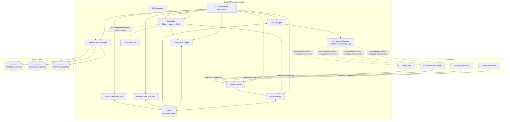
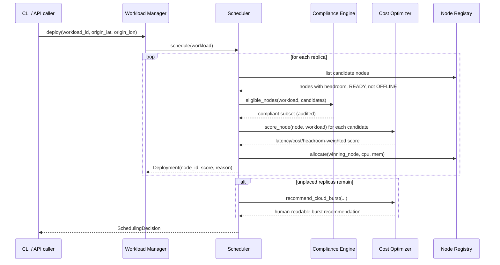
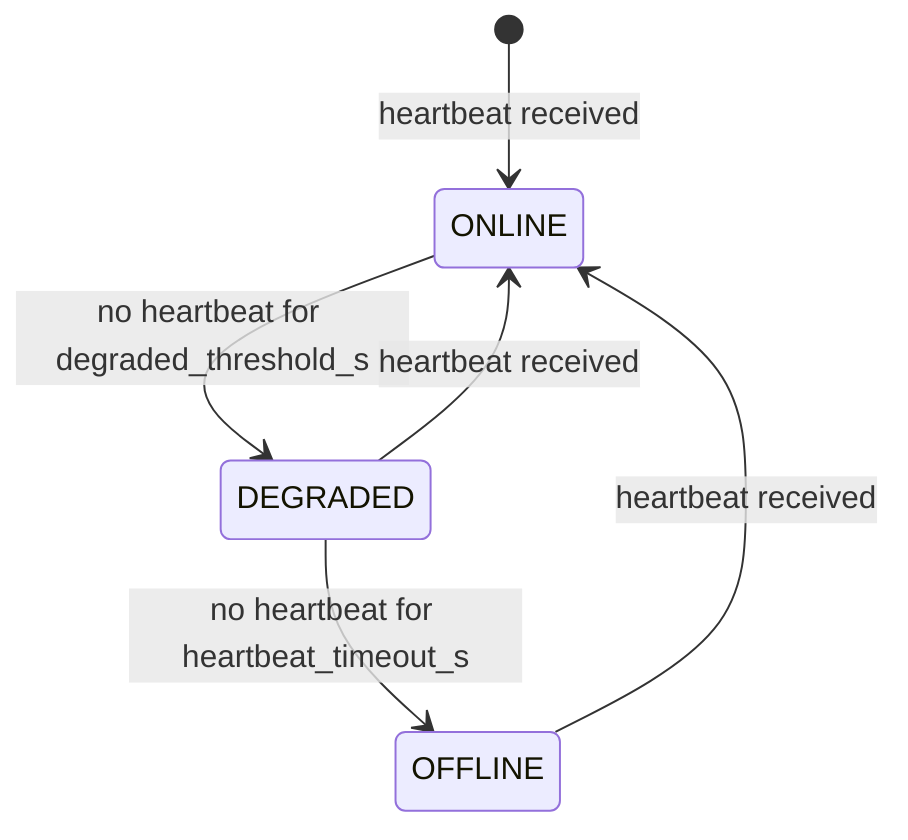
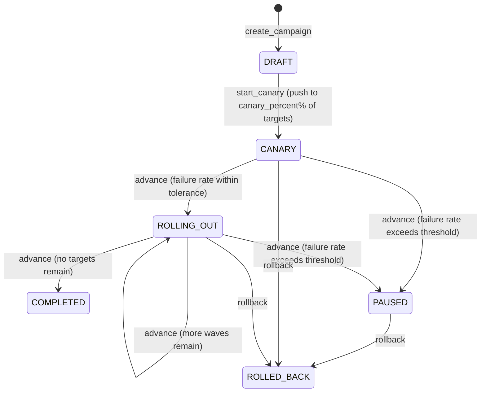

# Architecture

## System overview

## The scheduling pipeline

Each workload replica moves through four stages, mirroring the filter/score/bind
pattern used by Kubernetes' `kube-scheduler`, scoped to what matters for a
distributed edge fleet:

**Filter** eliminates nodes that cannot legally or physically run the
workload: insufficient CPU/memory, `OFFLINE` connectivity, node-type
affinity mismatch, or a data-residency violation.

**Score** ranks the surviving candidates using a linear weighted sum of
normalized latency, normalized cost, and a small headroom nudge away from
already-busy nodes. Workloads can shift the latency/cost balance via
`cost_priority: "latency" | "cost" | "balanced"`. The formula is
deliberately simple and inspectable — see `services/cost_optimizer.py` —
because "why did this land here" needs a plain-language answer for
compliance and cost review, not a black box.

**Bind** allocates resources on the winning node and persists a
`Deployment` record.

**Fallback**: if not all replicas can be placed, the scheduler asks the
cost optimizer whether a hybrid cloud burst (see `hybrid_cloud.py`) is a
better answer than leaving the workload under-replicated.

## Connectivity model

Edge fleets are defined by nodes that come and go. Rather than treating
connectivity as binary, the registry classifies each node from heartbeat
recency into three states:

While a node is `DEGRADED` or `OFFLINE`, control-plane intents (deploy,
stop, OTA update, policy change) are not dropped — they're placed on a
per-node durable queue (`services/connectivity.py`) and replayed once the
node's agent reconnects and calls `drain_queue`. This is the difference
between "the control plane thinks the store is fine because nothing
failed" and "the control plane correctly withheld new work from a store
it can't currently reach, and will catch it up the moment it's back."

## OTA rollout state machine

## Latency estimation

`cost_optimizer.estimate_latency_ms` combines great-circle distance
(haversine) with a per-connection-type overhead constant (wired < 5G <
Wi-Fi < 4G-LTE < satellite) to produce a *relative* signal between
candidate nodes. It is explicitly not a claim of physical accuracy —
production deployments should replace it with measured round-trip time
from an active latency-probe mesh (each node periodically pinging a
shared set of anchors), which is a drop-in swap: the scheduler only needs
something that implements `estimate_latency_ms(node, origin) -> float`.

## Why SQLite-as-document-store instead of an ORM

Each service owns one table, storing entities as JSON with a handful of
indexed columns pulled out for the filters that service actually needs
(region, connectivity state, campaign state, etc). This keeps the project
dependency-free while still getting SQLite's atomic writes and WAL-mode
concurrent reads. It is intentionally *not* a time-series store — health
metrics are capped per node (`MAX_SAMPLES_PER_NODE` in
`health_monitor.py`) and old samples are trimmed, because a control
plane's job is current operational state, not long-term analytics. Wire a
real metrics backend (Prometheus + long-term storage, or a data
warehouse) for that — `/metrics` is already exposed in a
Prometheus-compatible format for exactly this purpose.
